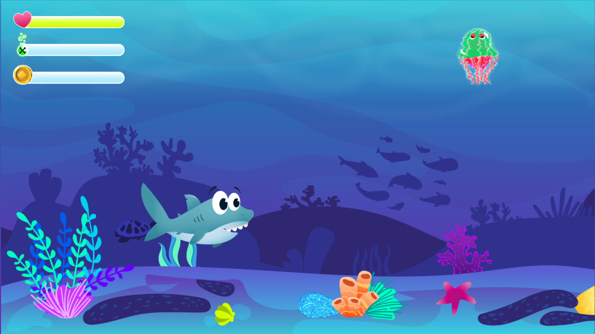

# Sharkie

A 2D underwater jump'n'run game for the browser. You steer a little shark through the sea, collect coins and potions, and fight your way past enemies. Built with vanilla JavaScript and object-oriented programming during my web development training at the Developer Akademie.

**Play it:** [sharkie.tobias-klanert.de](https://sharkie.tobias-klanert.de)



## About this project

- **Course project** from my web development training at [Developer Akademie GmbH](https://developerakademie.com/).
- **Graphics** provided by Developer Akademie GmbH.
- **Sounds** from [Freesound.org](https://freesound.org/).

## Features

- Multiple enemy types and boss fights
- Collectible coins and potions
- Animated characters and backgrounds
- Sound effects and background music, with a mute setting that your browser remembers

## How to play

| Action       | Key              |
|--------------|------------------|
| Move         | `←` `→` `↑` `↓`  |
| Attack       | `Space`          |
| Throw bubble | `D`              |

Collect coins and potions, avoid or defeat the enemies, and beat the bosses to complete the levels.

## Tech stack

| Area      | Choice                                                  |
|-----------|---------------------------------------------------------|
| Language  | Vanilla JavaScript, object-oriented                     |
| Rendering | HTML canvas                                             |
| Styling   | CSS                                                     |
| Hosting   | nginx container behind Caddy on my own Hetzner VPS      |

No framework, no build step, no external requests: every file the game needs comes from my own server.

## How it runs in production

Sharkie is a static site. On my VPS the repository is checked out and mounted read-only into a hardened nginx container: non-root user, read-only file system, no Linux capabilities. Hidden files such as `.git/` are blocked. Caddy sits in front of it as a reverse proxy and handles HTTPS. An update is a `git pull` on the server.

## Run it locally

Serve the folder with any static web server:

```bash
git clone https://github.com/TobiasKlanert/Sharkie.git
cd Sharkie
python3 -m http.server 8000
```

Then open [http://localhost:8000](http://localhost:8000).

## Project structure

```
Sharkie/
├── audio/       # Sound effects and music
├── graphics/    # Sprites and backgrounds
├── js/          # JavaScript files
├── levels/      # Level setup
├── models/      # Classes for the game objects
├── index.html   # Entry point
└── style.css    # Main stylesheet
```

## Contact

- Portfolio: [tobias-klanert.de](https://tobias-klanert.de)
- LinkedIn: [Tobias Klanert](https://www.linkedin.com/in/tobias-klanert-80563731a/)
- GitHub: [@TobiasKlanert](https://github.com/TobiasKlanert)

## License

No license is granted. The code is public so you can see how Sharkie is built. The graphics belong to Developer Akademie GmbH, the sounds to their creators on Freesound.org.
